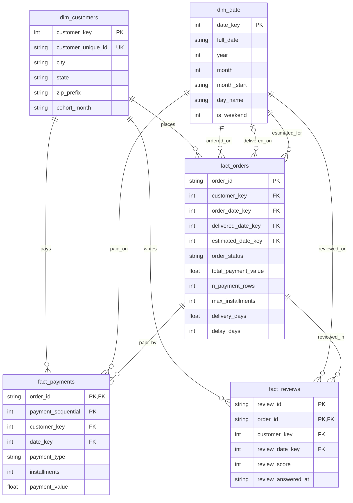

# Olist E-Commerce: Cohort Retention & Delivery Insights

Elevvo Data Analytics Internship, Task 9 (Industry Level): Business Insights & Executive Report for an E-Commerce Dataset.

**Business question:** Are customers acquired in 2017 still buying in 2018?

**Answer:** Barely. Only 1.5% (643 of 42,131) of customers acquired in 2017 bought again in Jan to Aug 2018. Growth comes almost entirely from new customers. The full write-up is in [`outputs/executive_summary.md`](outputs/executive_summary.md).


## Key results

| Finding | Result |
|---|---|
| 2017 customers who bought again in 2018 | 1.5% (643 of 42,131) |
| Highest single-cell cohort retention | 0.72% (Oct 2017 cohort, Month 1) |
| Customers who ever placed a second delivered order | 3.0% |
| Power Users (top 1%, 934 customers) | 10.3% of revenue, only 7.2% repeat buyers |
| Review score: on-time vs late delivery | 4.29 vs 2.27 stars |
| Share of negative reviews (1 to 2 stars): on-time vs late | 9.3% vs 62.4% |


## What this project covers

- **Cohort analysis:** monthly acquisition cohorts and a retention heatmap (Months 1 to 12).
- **Data modeling:** a star schema (2 dimensions, 3 fact tables) in SQLite with primary keys, foreign keys and integrity checks.
- **Validation:** the cohort analysis was rebuilt from the database and reproduces the raw-data results exactly (maximum difference 9.7e-17).
- **Bonus 1, Power Users:** the top 1% of customers by spend, their revenue share, repeat rate and state mix.
- **Bonus 2, delivery vs reviews:** delivery time and lateness against review score, overall and by state.

## Repository structure

```
business_insights_olist/
├── data/
│   ├── raw/             # original Olist CSVs (not committed)
│   └── processed/       # generated star-schema tables and SQLite database (not committed)
├── notebooks/
│   ├── 01_cleaning_and_schema.ipynb   # inspection, cleaning, star schema, SQLite load
│   └── 02_cohort_analysis.ipynb       # cohorts, heatmap, Power Users, delivery vs reviews
├── sql/
│   ├── 00_schema.sql                  # table definitions, keys, constraints, view
│   └── 01_monthly_summary.sql         # example star-join query
├── outputs/             # heatmap, delivery chart, executive summary
├── README.md
└── requirements.txt
```

## Data

[Brazilian E-Commerce Public Dataset by Olist](https://www.kaggle.com/datasets/olistbr/brazilian-ecommerce) (Kaggle). Download the CSV files and place them in `data/raw/`. The raw data is not committed to this repository.

## How to run

1. `pip install -r requirements.txt`
2. Put the Olist CSVs in `data/raw/`.
3. Run `notebooks/01_cleaning_and_schema.ipynb` from top to bottom. It builds the star schema and writes `data/processed/olist_star.db`.
4. Run `notebooks/02_cohort_analysis.ipynb`. It reads from the database and writes the charts to `outputs/`.

## Data model



**Design decisions**

- **Grain is stated for every fact.** `fact_orders`: one row per order. `fact_payments`: one row per payment. `fact_reviews`: one row per (`review_id`, `order_id`).
- **The real customer key is `customer_unique_id`.** In Olist, `customer_id` is unique per order, so cohorting on it would show 0% retention. `dim_customers` has one row per real customer and a generated surrogate key.
- **Payments are aggregated before they reach the order fact.** A naive orders-to-payments join returns 103,886 rows for 99,441 orders. `fact_orders` carries the order-level totals, and `fact_payments` keeps the detail.
- **`dim_date` plays three roles for `fact_orders`** (purchase, delivery, estimated delivery). The delivery key is optional because undelivered orders have no delivery date.
- **Reviews keep their natural grain.** The rule "one score per order" (the most recent review, ties broken by `review_id`) lives in the view `v_order_review`, so it is visible and easy to change.
- **Integrity is enforced by the database:** primary keys, foreign keys, a 1 to 5 check on review scores, and `PRAGMA foreign_key_check` returned 0 violations.

## Methodology

- A **purchase** is an order with status `delivered`.
- A **cohort** is the month of a customer's first delivered order, computed over all time so 2016 customers are not mislabeled as new. The analysis window is cohorts from Jan 2017 to Aug 2018.
- **Retention in Month N** (N ≥ 1) is the share of a cohort that ordered N months after the cohort month. Same-month repeat orders stay in Month 0.
- **Power Users** are customers at or above the 99th percentile of spend on delivered orders. Spend includes freight.
- **Late** means delivered on a later calendar day than the estimated date.
- Delivery and review analysis uses delivered orders with a delivery time and one review score per order.

## Limitations

- Delivered data ends in Aug 2018, so the final calendar month is understated, and later cohorts have fewer observable months.
- Early cohorts are small (Jan 2017: 717 customers), so their percentages are noisy.
- Delivery and review findings are associations, not proof of cause. State-level correlations partly restate the order-level result.
- A customer is identified by `customer_unique_id`, so someone using two accounts counts as two people.

## Tools

Python (pandas, NumPy, seaborn, matplotlib), SQL (SQLite), Jupyter.
