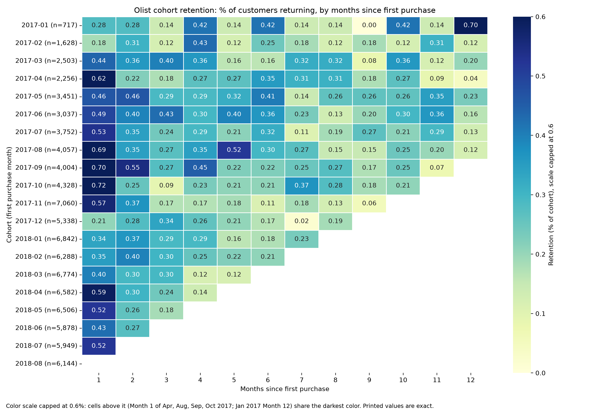
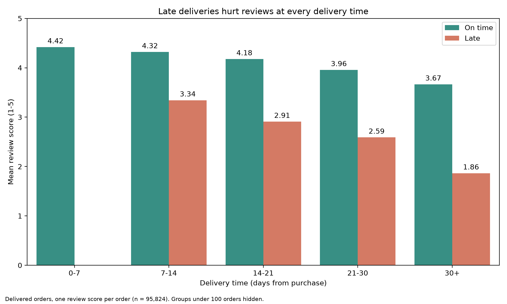

# Olist E-Commerce: Customer Retention & Delivery Insights

**Executive summary** | Analysis window: Jan 2017 to Aug 2018 | Prepared by Toluwalase Aderemi

## The answer

**Are customers acquired in 2017 still buying in 2018? Barely.** Only 1.5% of them (643 of 42,131) placed another order in Jan to Aug 2018. Olist's growth comes almost entirely from acquiring new customers, not from bringing existing ones back.

| Metric | Value |
|---|---|
| 2017 customers who bought again in 2018 | 1.5% (643 of 42,131) |
| Share of 2018 orders from 2017 customers | 1.4% |
| Repeat rate of top 1% spenders (Power Users) | 7.2% (vs 3.0% for all customers) |
| Mean review score, on-time vs late delivery | 4.29 vs 2.27 |

## Key findings

### 1. Retention is very low in every cohort

- In every cohort, fewer than 1 in 100 customers returns in any given month after their first purchase (highest cell: 0.72%).
- Only 3.0% of customers ever placed a second delivered order.
- About 96.6% of 2018 orders were a customer's first-ever delivered order, so order volume (6,000 to 7,000 a month) was sustained by new customers.
- Month 1 returns peak for the Aug to Oct 2017 cohorts (0.69% to 0.72%), whose return month fell near Black Friday. There is no clear evidence that Black Friday cohorts retain worse.

### 2. The most valuable customers do not come back either

- The top 1% of customers (934 people, each spending at least BRL 1,097) generate 10.3% of revenue and spend about 10x the average customer.
- 92.8% of them bought only once. They return only slightly more often than everyone else (7.2% vs 3.0%).
- Power Users are spread across the country. São Paulo is under-represented (42% of customers, 32% of Power Users).

### 3. Late delivery is the clearest driver of bad reviews

- On-time orders average 4.29 stars (9.3% negative). Late orders, about 7% of the total, average 2.27 stars (62.4% negative).
- Late orders produce roughly a third of all negative reviews, so about two-thirds of negative reviews come from other causes that this data cannot explain.
- **Missing the promised date hurts more than a long wait.** A late order delivered in 7 to 14 days (3.34 stars) scores below an on-time order that took 30+ days (3.67).
- Beyond about 21 days, scores drop sharply (2.25 stars at 30+ days).
- By state, delivery times range from 8.8 days (SP) to 26.4 days (AM). The states with the highest late shares (AL 20.8%, MA 17.1%, SE 15.0%) have the weakest review scores.

## Recommendations

These follow from the findings, and each should be tested before a full rollout.

1. **Run a second-purchase campaign for first-time buyers.** Returns peak in Months 1 to 3, so test an offer sent in the first weeks after delivery, measured with an A/B test against no offer.
2. **Treat high-value first-time buyers as a priority segment.** 93 in 100 never return, so test personal follow-up for orders above about BRL 1,100.
3. **Protect the delivery promise before chasing average speed.** Prioritize states with high late shares and high volume (RJ and BA are both near 12% late). Test proactive messages to customers whose orders are running late.
4. **Investigate the other two-thirds of negative reviews.** Product, seller and item data (not in this model) are needed.

## Method and caveats

- A purchase is a delivered order. A customer is a `customer_unique_id` (Olist's `customer_id` changes with every order). A cohort is the month of a customer's first delivered order.
- Retention counts a customer in Month N (N ≥ 1) if they ordered N months after their cohort month. Same-month repeat orders stay in Month 0.
- Delivered data ends in Aug 2018, so the final calendar month is understated. Early cohorts are small (Jan 2017: 717 customers), and their percentages are noisy.
- Customer spend includes freight. Review analysis uses one score per order (the most recent review) and covers 99.3% of delivered orders with a delivery time.
- Delivery and review findings are associations, not proof of cause. The state-level correlation (-0.90 between late share and mean score, 24 states) partly restates the order-level result.
- All analysis runs on a star schema (two dimensions, three fact tables) in SQLite, validated by reproducing the raw-data results exactly. See the notebooks and the `sql/` folder.
